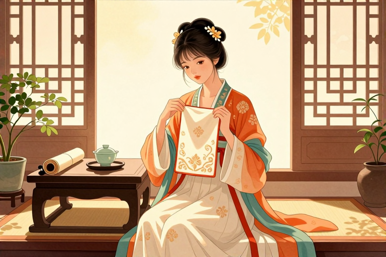

# 汉服蔽膝是什么意思

每逢传统节庆或祭祀大典，身着宽袍大袖的人低头行礼时，大腿至膝前总会垂下一块梯形织物。这块不拖地、不系在腰上的布帛或皮革，就是蔽膝。它最初只是先民遮羞御寒的原始遗制，后来硬生生挤进了古代礼服体系，成了先秦时期与佩玉并列的身份标识。从商周的斧形样式到明清祭服里的固定配件，这块围在大腿前的大巾，装下了几千年的礼俗变迁与生活烟火。

## 蔽膝最早是干什么用的

它最初就是先民用来遮羞和劳作的实用物件。远古时期生产力低下，人们狩猎采集后最先想到的是用兽皮遮挡身体关键部位，后来才逐渐知道遮盖后方。这种原始的遮羞物随着时代推进被纳入衣裳制礼服组件，商周时期定型为上窄下宽的斧形样式。当时贵族在祭祀或朝会时穿戴它，不仅为了蔽护膝盖，更是为了彰显地位。先秦时期材质多为皮革，到了汉代以后才逐渐改用轻薄的布帛。古人将其保留在礼服上，并非刻意复古，而是认为重古道、不忘本能体现对祖先的追思。如今我们在博物馆里看到的那些出土实物，比如苏州曹氏墓出土的元末翟鸟纹素罗蔽膝，依然能看出它梯形上窄下宽的结构，上端还留着穿带的绢攀。想感受它的实用初衷，不妨在参与传统农耕体验或汉服游园活动时，留意那些平民用布帛制作的简易款式，它们保留了早期蔽膝作为劳作围裙的朴素面目。

## 为什么古代蔽膝颜色分等级

因为它是先秦时期别尊卑、章有德的重要礼制符号。西周将蔽膝正式纳入礼服体系后，统治阶层立刻用它来划分社会等级。天子祭祀用纯朱色的蔽膝，诸侯则用黄朱色，大夫以上才能佩戴赤芾，颜色与纹样都有严格规定。早期蔽膝多为纯色，仅施加山、龙、火三个纹样以象征权力。唐代以后纹样趋于丰富，贵族在穿戴时通常遵循以下搭配要点：

- 联珠纹与龟背纹多见于缯帛质地

- 颜色严格对应身份，天子用朱色诸侯用赤色

晚唐五代时期甚至出现了前后两片、下摆呈花瓣形的款式。金代女真人引入汉族蔽膝后，又创新出两侧开衩、长度自胸至膝的形制，兼顾了骑射保暖的需求。今天穿戴时不必拘泥于古代等级，只需根据场合选择朱色或赤色搭配祭服与朝服，就能直观感受到那种庄重感。

## 女子穿蔽膝有哪些特殊款式

历代仕女会根据季节与场合挑选不同飘带与下摆的款式。魏晋至隋唐时期，名媛贵妇最流行襳髾蔽膝，这种款式在下方缀有数条长长的三角形飘带，走动时衣袂翻飞极具美感。唐代女子偏爱缯帛质地，上面绣着联珠纹或龟背纹，既轻便又华丽。晚唐五代时期，前后两片、下摆呈现花瓣形的蔽膝成为新潮流，常与大袖衫一同穿着出席寻芳逐胜的雅集。到了宋代以后，蔽膝逐渐退出日常，主要保留在祭服与朝服中，材质选用更加轻薄的罗等丝织物。金代齐国王墓出土过一件褐地朵梅鸾章棉蔽膝，两侧开衩自胸至膝，系带复杂，体现了女真族对汉族服饰制度的借鉴与创新。如今在传统节日里穿着汉服，可以挑选带有飘带的襳髾款搭配曲裾或大袖衫，还原古代女性出游时的轻盈姿态。

## 现在穿汉服怎么搭配蔽膝

现代复原穿戴主要遵循对齐下缘与固定系带的步骤。穿着时先将蔽膝垂于衣服正前方，要求它与衣裳制礼服的帷裳下缘齐平，不能直接系到腰上，而是拴到大带上作为装饰。具体操作步骤如下：

- 将蔽膝梯形上窄下宽的一端朝上对齐腰线

- 左右两侧钉有的四对系带在腰部或侧面打结固定

- 检查前后合围是否平整，确保不拖地且能蔽护膝盖

日常劳作或汉服复原中，可依据季节选用皮革、布帛或罗等丝织物。春季选素色显清雅，秋季配赤色应秋收之景。蔽膝从上古遮羞物演变为礼服配饰，再到金代结合骑射生活进行功能性改良，其材质与纹样的变迁本身就是一部古代社会经济与审美观念的缩影。周末参与传统节庆或汉服雅集时，按照上述步骤穿戴，再配上对应的佩玉或发饰，便能完整体验古人重古道的礼仪氛围。

从原始遮羞物到礼制标识，从商周斧形到唐代缯帛，蔽膝的演变轨迹清晰刻录在古代服饰体系之中。它不仅是区分尊卑的政治符号，也是历代百姓劳作御寒的生活物件，更是各民族文化交流融合的实物见证。如今我们在传统节日或文化活动中穿戴汉服，不必纠结于严苛的古制等级，只需理解其形制背后的礼俗逻辑。这个周末不妨走进博物馆看看出土的翟鸟纹蔽膝原件，或者去一场汉服游园会亲自体验系带与垂坠的手感，让挂在腿前的这块织物重新呼吸历史的温度。

## 常见问题

### 古代蔽膝只有男子才能穿吗？

并非如此。男女服饰中皆可见其身影，魏晋至五代时期贵族妇女和侍女也常将其作为搭配元素，款式涵盖襳髾蔽膝与花瓣形蔽膝，金代更出现适合骑射的两侧开衩长款。

### 传统节庆穿汉服需要戴蔽膝吗？

并非强制要求。蔽膝主要保留于祭服、朝服等礼仪场合，日常节庆穿着可根据个人喜好选择。若参与国家祭祀或传统冠婚之礼，佩戴蔽膝能更完整还原古制礼服体系。

### 蔽膝的材质会随着季节更换吗？

会。先秦多用皮革御寒，汉代后逐渐演变为轻薄的布帛材料。唐代喜欢用缯帛，宋以后选用更加轻薄的罗等丝织物制作。现代复原可根据春夏穿罗帛、秋冬穿素锦或棉质来调整。

### 蔽膝上的纹样有什么讲究？

早期多为纯色并施加山、龙、火三个纹样以象征权力与等级。唐代以后纹样趋于丰富，如联珠纹、龟背纹等。颜色则有朱、赤、素、爵等，不同纹样与色彩在古代直接对应穿着者的社会身份。

### 现代复原蔽膝和古代原版一样吗？

形制大体一致但细节有调整。古代蔽膝多为前后合围式通过绦带或系带固定，现代复原品保留了梯形结构与垂坠设计，材质多改用易打理的仿丝织物，便于日常穿着与文化推广活动使用。

---

- 本站：[https://zlaiw.com/](https://zlaiw.com/)
- 本文 GitHub Pages 页面：https://mhxy-88.github.io/zlaiw-archive/pages/%E6%B1%89%E6%9C%8D%E8%94%BD%E8%86%9D%E6%98%AF%E4%BB%80%E4%B9%88%E6%84%8F%E6%80%9D.html
