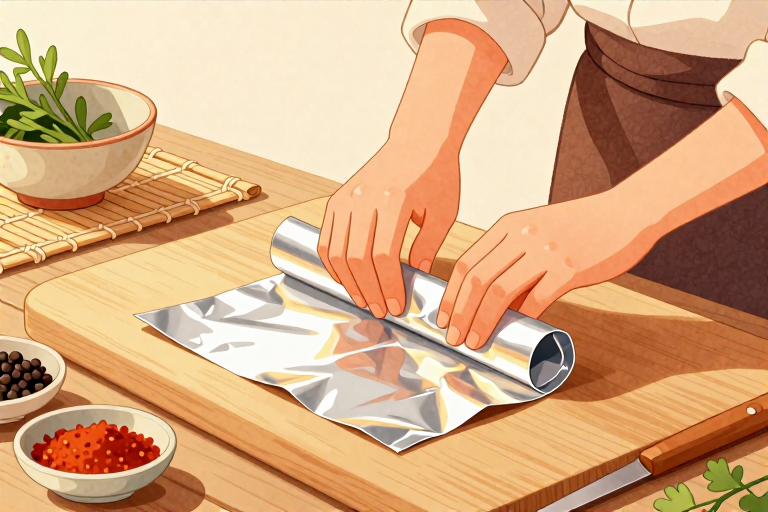

# 锡纸使用技巧有哪些

很多人把铝箔箔（市面常说的锡纸）只当成烤肉或者包饺子的消耗品，用一次就扔。实际上它是一层极薄的金属屏障，导热快、隔绝空气、物理阻隔强，换个思路看厨房和家居角落，能省下的时间比买清洁剂的钱多得多。核心答案很简单：别把它当包装膜，要把它当工具。利用它的隔热导温特性保护灶具锅具，靠它的致密结构防潮防串味，借它表面的微粗糙度代替钢丝球去污，甚至裁成条状临时充当线缆扎带或简易漏斗，都能把一件快被丢弃的日用品的价值榨干。

## 烤箱烤盘怎么防粘

周末做烘焙或者烤肉类料理时，最怕的就是酱汁渗进烤盘的网格缝隙里。冷却后那些焦糖化的糖浆和蛋白质会像钉子一样死死咬住金属表面，铲刀刮了半天只留下白痕。这时候提前铺一层锡纸就能避开硬碰硬的刷洗。把铝箔裁成比烤盘略大两指宽的尺寸，边缘顺着模具折出直角，底部不用抹油也能形成物理隔离层。

注意摆放的间距很关键。如果食物直接压死在箔面上，接触面会迅速升温并发生美拉德反应后的黏连。正确做法是让锡纸拱起一个缓坡，或者用耐高温的小陶瓷支架把铝箔托起来半悬空。热空气能在夹层里对流循环，热量传递更均匀，底部不会先糊而表面还夹生。烤完放凉半小时再揭下来，残留在箔面上的油脂一搓就掉，连洗洁精都省了。

## 微波炉能不能用锡纸

把烤箱里的经验直接搬到微波区是厨房事故的高发点。金属在磁场里会感应出涡流，微波遇到导体表面会产生反射和聚集。当箔片的边缘翘起或者被揉皱成尖锐的折角时，电场强度会在那些微小结点上突破空气绝缘阈值，瞬间拉出蓝紫色的电弧。不仅铝箔会被烧穿打洞，磁控管也会因为能量回冲而过热保护。

日常加热饭菜必须彻底放弃金属箔。微波炉专用的保鲜膜或者玻璃陶瓷盖才是正解。如果实在需要遮挡水汽防止汤汁飞溅，把烘焙纸或厨房纸巾平铺在碗口就行。纸张的纤维结构允许微波穿透，同时能吸附溢出的油滴。遇到带金边描银装饰的瓷盘也要同样警惕，那些看似不起眼的线条其实就是金属箔冲压上去的图案，进炉前用指甲刮一下就能确认材质差异。

## 不锈钢锅油污怎么擦

锅底那层烧黑的积碳和灶台边缘溅出的老油垢，光靠百洁布干搓只会留下满手划痕。把一团废弃的铝箔揉成紧实的球状，粗面贴在污渍处反复打圈摩擦。金属表面的微观凹凸在受力时会充当微型研磨剂，硬度足以刮除氧化层却不会像钢丝球那样破坏不粘涂层的分子结构。遇到顽固的水渍或铁锈斑点时，往搓洗区域滴两滴白醋或者柠檬汁。

酸性物质接触铝箔会释放极微量的氢气气泡，这些细密的气泡在缝隙里膨胀破裂能撬开附着层。配合少量小苏打粉调成糊状敷上十分钟再擦，原本发乌的锅底会露出金属本来的光泽。操作时戴一副薄橡胶手套防烫手就行，洗下来的黑泥直接冲进水槽，不用费心抠洗碗池滤网里的残渣。

## 衣柜抽屉防潮妙招

南方梅雨季或者老房子的木质橱柜里，衣物受潮发霉是常事。毛呢大衣和真丝衬衫最怕的是看不见的湿气凝结在纤维深处，等摸到发硬的时候已经滋生黄斑了。把整张铝箔裁成比抽屉底板略小的尺寸，亮面朝上铺平，上面再垫一层旧棉布或者宣纸做缓冲层。

金属的致密结构能彻底阻断地气上升带来的水汽渗透，同时反射部分环境温差防止冷凝水形成。衣柜角落容易积灰的地方塞一团揉皱的箔球也能防虫防潮，蚂蚁和衣蛾不喜欢在光滑反光的表面爬行产卵。换季收纳外套时，把锡纸剪成细长条缠绕在木质衣架的肩膀处，能减少布料长期受压产生的折痕记忆。存放干货香料前也在密封罐底部垫半张铝箔，隔绝空气中的硫化物防止辣椒面和胡椒粉变色发苦。

## 日常旧物临时改造

家里做手工或者整理工具时，总会遇到临时缺小物件的尴尬时刻。裁一条长约十厘米宽的箔带对折两次，两头捏紧就能充当临时的线缆扎带或管道包裹层。需要给油漆桶口加个导流嘴时，把铝箔卷成圆锥筒状粘在边缘，倒涂料的时候不会顺着瓶身滴得到处都是。

旧木筷子的尾部容易开裂或者烫手，套上一截折叠好的锡纸并用手指捻紧，就能变成耐高温的烘焙夹。园艺修剪完树枝后，切口用铝箔包住绑牢能防雨水灌入导致腐烂。遇到塑料收纳盒卡扣断裂无法密封时，裁一块比裂口大两指的箔片从外侧跨过去压住边缘，再用透明胶带固定几道，临时挡水防风完全够用。这些用法不依赖特殊工具，随手就能处理日常的小麻烦。

铝箔的实用价值不在它的价格标签上，而在你能否看穿它作为金属薄片的物理本质。导热、阻隔、塑形、替代研磨，掌握这几条底线逻辑，厨房清洁和家居收纳里的硬骨头自然迎刃而解。

---

- 本站：[https://zlaiw.com/](https://zlaiw.com/)
- 本文 GitHub Pages 页面：https://mhxy-88.github.io/zlaiw-archive/pages/%E9%94%A1%E7%BA%B8%E4%BD%BF%E7%94%A8%E6%8A%80%E5%B7%A7%E6%9C%89%E5%93%AA%E4%BA%9B.html
