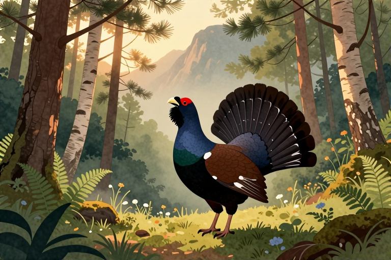

# 黑嘴松鸡在兴安岭求偶舞

每年三月中旬到四月初，兴安岭的残雪还没完全化开，黑嘴松鸡的求偶舞就已经准时开场。雄性会在林缘清理出一块直径两三米的圆形空地，随后竖起眼下的红色肉垂，连续拍打翅膀发出类似鼓点的低频震动。这并非毫无章法的蹦跳，而是一套经过千万年演化的精密信号系统，直接决定它们能否获得繁衍后代的机会。

## 求偶舞具体长什么样

求偶舞的核心动作是清理场地、扬起羽毛与连续发声的三步组合。雄性黑嘴松鸡会先啄开积雪下的枯枝落叶，用宽大的脚掌反复刨出一个直径约两米的圆形舞台，确保周围没有任何遮挡物。随后它压低身体，将颈部的羽冠瞬间竖立起来，让眼下的红色肉垂完全暴露在外，形成强烈的视觉反差。这套动作背后的科学原理在于视觉与听觉的双重信号传递：鲜艳的肉质器官能直接刺激雌鸟的繁殖本能，而翅膀拍打地面或枯木产生的低频震动，则能在零下十几度的空气中穿透茂密的针叶林。在林缘地带观察时，你往往先听到类似闷鼓的“咚、咚”声，循着声音拨开灌木，就能看到雄性正单脚站立，另一只脚有节奏地敲击树根。整个身体随着节拍微微起伏，尾羽如扇子般展开，这种高度同步的生理反应，正是为了向潜在配偶展示自身的健康状态与基因优势。若使用长焦镜头记录，可清晰捕捉到它喉部气囊的快速收缩过程。雌鸟通常会停在三十米外的枝头进行静态评估。

## 为什么要清理出圆形空地

清理出圆形空地的根本原因是为了构建无遮挡的声学共振场与视觉焦点。在复杂的针阔混交林中，杂乱的植被会严重衰减低频声音的传播距离。雄性通过物理清除动作，将原本散乱的地面声波反射路径简化成规则的同心圆结构，使求偶鼓点能沿地表无损传播至百米之外。这种行为本质上是一种环境改造策略。

- 声学扩音：裸露的冻土与枯枝能有效传导低频震动，避免声音被苔藓吸收

- 视觉引导：圆形边界在茂密背景中形成天然画框，雌鸟只需扫视林缘即可锁定目标

- 领地宣示：定期修补边缘能防止其他雄性入侵，确保求偶权的独占性

春季气温回升时，融雪会在空地中央留下湿润的泥土带。此时若用高倍望远镜观察，会发现雄性会不断调整站位，始终将身体正对雌鸟可能飞来的方向。这种对环境声学与光学的精准利用，让原本不起眼的林间空地变成了天然的露天剧场。

## 红色肉垂到底有什么用

眼部下方的红色肉垂是衡量雄性健康状况与免疫力的直接生理指标。在漫长的冬季里，黑嘴松鸡依靠啃食针叶和地衣维持生命，体内营养储备差异巨大。当求偶期到来时，血液会加速流向头部毛细血管，促使原本灰暗的皮肤充血膨胀成鲜红色。这种颜色变化无法伪装，完全取决于个体的代谢水平与抗病能力。雌鸟在挑选配偶时，肉垂的色泽与对称度就是最可靠的基因质检报告。

- 充血程度：舞跳得越激烈，血流量越大，颜色会由暗红转为亮红

- 恢复周期：受伤或感染的个体肉垂萎缩缓慢，求偶成功率显著下降

- 动态对比：竖起羽冠时肉垂面积扩大两倍，形成强烈的视觉冲击波

在兴安岭的早春林地里，雌鸟往往会在几块相邻的空地间来回徘徊。它们并不急于靠近，而是长时间驻足观察雄性拍打翅膀的频率与肉垂的起伏节奏。这种看似挑剔的行为，实际上是自然选择留下的生存法则：只有能维持高耗能舞蹈且保持器官鲜亮的个体，才具备让后代在恶劣环境中存活下来的潜力。

## 求偶舞会持续多长时间

一场完整的求偶舞通常持续十五到二十分钟，但整个繁殖季会反复上演数十次。黑嘴松鸡属于高能耗的视觉与听觉信号输出者，连续拍打翅膀和快速呼吸会迅速消耗体内糖原储备。因此，它们的舞蹈并非马拉松式的持久战，而是短促、高强度的爆发式表演。这种行为受到昼夜节律与气象条件的严格制约。

- 黄金时段：清晨日出后两小时与傍晚日落前一小时是活动高峰

- 天气阈值：风力超过四级或气温低于零下十五度时，舞蹈会直接取消

- 季节跨度：从三月中旬破雪开始，到四月底雌鸟产卵前结束

在兴安岭北段的落叶松林带，如果你连续多日在同一处空地守候，会发现雄性的表演频率会逐渐降低。这是因为求偶不仅是体力活，更是心理博弈。当某只雄性成功吸引雌鸟进入巢区后，它会立刻停止舞蹈并转移阵地。这种高效的时间管理策略，避免了无谓的能量浪费，也确保了整个种群能在短暂的北半球春季窗口期内完成繁衍任务。

黑嘴松鸡的求偶舞并非简单的卖弄，而是一套融合了声学扩音、视觉信号与生理展示的精密生存策略。它们清理空地以传导低频鼓点，用充血肉垂证明基因质量，并在短暂的早春窗口期内高效完成交配权争夺。这套行为模式完美契合了寒温带针叶林的环境压力与自然选择逻辑。

下次走进兴安岭的林缘地带时，不妨带上高倍望远镜与静音登山杖。在清晨薄雾未散时保持距离静候，留意那些发出闷鼓声的枯木区域。不要开闪光灯，不要大声交谈，静静记录它们拍打翅膀的频率与肉垂起伏的节奏。你会发现，大自然最动人的繁衍仪式，往往就藏在这些克制而精准的日常动作里。

## 常见问题

### 黑嘴松鸡求偶为什么会发出鼓点声

翅膀拍打地面或枯木会产生低频机械震动。这种声音传播距离远且不易被植被吸收，主要用于在茂密针叶林中宣示领地，同时为视觉展示提供节奏引导，帮助雌鸟快速锁定雄性位置。

### 红色肉垂变色说明什么健康状况

代表血液充盈与代谢水平正常。求偶期头部毛细血管扩张充血，颜色越鲜艳说明个体免疫力越强、营养储备充足，是雌鸟挑选配偶的核心生理指标。

### 为什么要在雪地清理圆形空地

为了构建无遮挡的声学共振场。裸露地面能有效传导低频鼓点，避免声音被苔藓吸收；同时圆形边界在复杂林缘形成天然视觉焦点，方便雌鸟远距离识别。

### 求偶舞失败会有生存风险吗

不会直接导致死亡，但会错失繁衍机会。失败个体仅能消耗大量体力并承受一定应激反应，次年春季仍会重新参与竞争，自然选择会通过基因筛选淘汰弱势者。

### 什么时候去兴安岭能看到求偶舞

每年三月中旬至四月初最佳。此时残雪未化、气温回升，雄性开始清理林地并发出低频鼓点。清晨日出后两小时是活动高峰，需保持安静远距离观察。

---

- 本站：[https://zlaiw.com/](https://zlaiw.com/)
- 本文 GitHub Pages 页面：https://mhxy-88.github.io/zlaiw-archive/pages/%E9%BB%91%E5%98%B4%E6%9D%BE%E9%B8%A1%E5%9C%A8%E5%85%B4%E5%AE%89%E5%B2%AD%E6%B1%82%E5%81%B6%E8%88%9E.html
